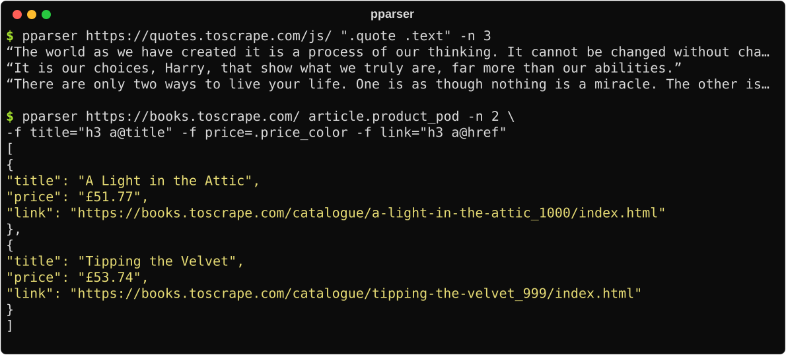
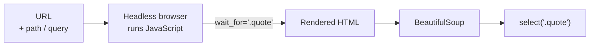

<div align="center">

# 🕸 pparser

**Parse pages the way a browser sees them.**

`pparser` opens a page in a headless browser
([Playwright](https://playwright.dev/python/)), waits for JavaScript to render
the content and gives you a [BeautifulSoup](https://www.crummy.com/software/BeautifulSoup/bs4/doc/)
object. It also merges query parameters for you, which makes search and
pagination one line each. It works as a Python library and from the command line.

[](https://github.com/mredwardlik/pparser/actions/workflows/tests.yml)




</div>

---

## 🤔 Why

Many sites build their pages with JavaScript. A plain HTTP request to
[quotes.toscrape.com/js](https://quotes.toscrape.com/js/) gets an HTML page
with **zero** quotes in it, because the browser adds them later. pparser loads
the page in a real browser, waits for the quotes to appear and only then
parses the HTML.



## ✨ Features

- 🌐 **Rendered pages**: Chromium, Firefox or WebKit through Playwright, or a
  browser you already have (`channel="chrome"`, `channel="msedge"`)
- ⏳ **Waiting**: for a CSS selector, for network idle or just a short delay
- 🔗 **URL helpers**: change the path or merge query parameters (`page=2`)
  without building URLs by hand. `None` removes a parameter
- ♻️ **One browser for every request**: it starts on the first request and
  closes with the `with` block
- 🧯 **Clear errors**: `PageLoadError` for HTTP errors, network errors and
  timeouts, and a hint if the browser is not installed
- 💻 **CLI**: print text, attributes or JSON records straight from the terminal

## 🚀 Installation

```bash
pip install git+https://github.com/mredwardlik/pparser.git
python -m playwright install chromium     # downloads the browser once
```

Python 3.9 or newer. If you already have Chrome or Edge, you can skip the
second command and pass `channel="chrome"` / `--channel chrome`.

## 🐍 Usage

```python
from pparser import PParser

with PParser('https://quotes.toscrape.com/js/') as pp:
    # wait until JavaScript adds the quotes, then select them
    for quote in pp.select('.quote', wait_for='.quote'):
        text = quote.select_one('.text').get_text(strip=True)
        author = quote.select_one('.author').get_text(strip=True)
        print(f'{text} — {author}')

    # another page of the same site
    soup = pp.soup(path='/js/page/2/', wait_for='.quote')
    print(soup.title.string)
```

### Search and pagination with query parameters

```python
from pparser import PParser

with PParser('https://www.scrapethissite.com/pages/forms/?q=new+york') as pp:
    for page in (1, 2, 3):
        # opens ...?q=new+york&page_num=1, then page_num=2 and 3
        for team in pp.select('tr.team', query={'page_num': page}):
            print(team.select_one('.name').get_text(strip=True))

    pp.url(query={'q': 'boston', 'page_num': None})
    # 'https://www.scrapethissite.com/pages/forms/?q=boston'
```

### Methods

| Method                                  | Returns                                     |
| --------------------------------------- | ------------------------------------------- |
| `pp.soup(path=None, query=None, ...)`   | `BeautifulSoup` of the rendered page        |
| `pp.select(selector, limit=None, ...)`  | list of matching elements                   |
| `pp.select_one(selector, ...)`          | first matching element or `None`            |
| `pp.html(path=None, query=None, ...)`   | rendered HTML as a string                   |
| `pp.url(path=None, query=None)`         | the URL that a request would open           |
| `pp.screenshot('page.png')`             | saves a screenshot of the last page         |
| `pp.close()`                            | stops the browser (`with` does it for you)  |

Loading options for `soup`, `select`, `select_one` and `html`:

| Option        | Default  | Description                                                     |
| ------------- | -------- | --------------------------------------------------------------- |
| `path`        | `None`   | another path on the site: `/page/2/` or relative `page/2/`      |
| `query`       | `None`   | parameters to add or replace: `dict` or `"a=1&b=2"`            |
| `wait_for`    | `None`   | CSS selector to wait for                                        |
| `wait_until`  | `load`   | `load`, `domcontentloaded`, `networkidle` or `commit`           |
| `delay`       | `0`      | extra pause after the page is ready, in seconds                 |
| `timeout`     | `15`     | timeout for this page, in seconds                               |

Browser options for `PParser(url, **options)`: `browser` (`chromium`,
`firefox`, `webkit`), `headless`, `width`, `height`, `timeout`, `user_agent`,
`locale`, plus any [Playwright launch option](https://playwright.dev/python/docs/api/class-browsertype#browser-type-launch)
such as `channel` or `proxy`.

## 💻 Command line

```bash
# text of every element (waits for the selector to appear)
pparser https://quotes.toscrape.com/js/ ".quote .text"

# an attribute: links are made absolute
pparser https://books.toscrape.com/ "h3 a" --attr href

# records as JSON: NAME=SELECTOR, NAME=SELECTOR@ATTR or NAME=@ATTR
pparser https://books.toscrape.com/ article.product_pod \
    -f title="h3 a@title" -f price=.price_color -f link="h3 a@href" > books.json

# query parameters, a limit and a screenshot for debugging
pparser "https://www.scrapethissite.com/pages/forms/" tr.team \
    -q q=boston -f team=.name -f year=.year -f wins=.wins -n 5 --screenshot page.png
```

Other options: `--wait-for SELECTOR`, `--no-wait`, `--timeout`, `--json`,
`--browser firefox`, `--channel chrome`, `--headed`. Exit codes: `0` found,
`1` error, `3` nothing matches.

## 🗂 Project structure

```text
pparser/
├── pparser/
│   ├── main.py         # PParser: soup(), select(), select_one(), html(), url()
│   ├── pbrowser.py     # PBrowser: Playwright wrapper with one reusable tab
│   ├── url_parser.py   # UrlParser: change path and query, resolve links
│   ├── utils.py        # query helpers
│   ├── errors.py       # PageLoadError, BrowserNotInstalledError
│   └── cli.py          # command line interface
├── examples/
│   ├── quotes.py       # JavaScript-rendered quotes, following "Next" links
│   └── hockey.py       # search + pagination through query parameters
└── tests/              # pytest, with a local test server
```

## 🧪 Tests

```bash
pip install -e ".[dev]"
python -m playwright install chromium
pytest
```

Browser tests run against a small local server with a JavaScript-rendered
page, so they don't depend on any website. Set `PPARSER_CHANNEL=chrome` (or
`msedge`) to run them with an installed browser instead.

> [!NOTE]
> pparser uses Playwright's synchronous API. Inside an `asyncio` event loop
> (for example in Jupyter) use Playwright's async API directly.

## 📄 License

[MIT](LICENSE)
